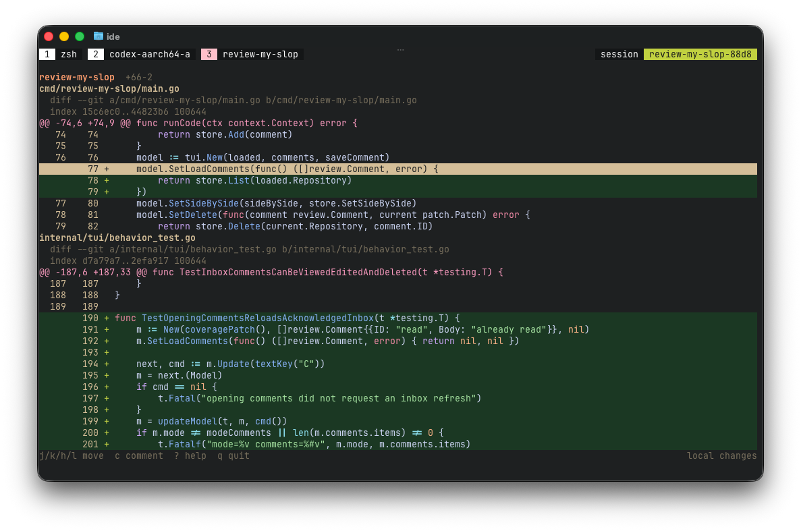

# review-my-slop



Coding has moved from the editor to the chat window. Agents can produce code at
a pace that makes reading the code a bottleneck.

However, without supervision, agents tend to slowly accumulate technical debt.
That debt increases the likelihood of mistakes, which in turn create more debt
and hidden bugs. By the time an agent burns through tokens on simple changes, it
is usually too late to correct course.

This is not simply an agent problem. Successful collaboration between the
developer and the agent requires a shared understanding of the codebase. The
mission of `review-my-slop` is to keep developers in the loop throughout their
coding projects, from start to finish.

`review-my-slop` is a keyboard-driven terminal diff viewer for reviewing local
changes, attaching comments to exact lines or ranges, and handing that feedback
back to the agent with one command.

## The review loop

1. Prompt the agent to make the initial change.
2. Review that slop by running `review-my-slop code` in the repository.
3. Read the diff and attach comments to individual lines or ranges.
4. Let the agent review your slop comments by asking it to run
   `review-my-slop comments` and act on them.
5. Repeat from step 2 until the code is no longer slop.

The review UI uses Vim-like key bindings for navigation, selection, search, and
comments. Press `?` at any time to see the complete key map.

All data stays truly local, and no telemetry is sent.

## Install

```sh
brew install EskelinenAntti/cli/review-my-slop
```

The project is licensed under the [MIT License](LICENSE).

## Development

Run `make check` for Revive, `go vet`, and Staticcheck (install Staticcheck
separately), and `make test` for race-enabled tests.

`make revive` runs standalone [Revive](https://github.com/revive-lint/revive)
v1.17.0 through `go run`, so no separate Revive installation is needed. The
version is pinned in the Makefile and shared with CI. `revive.toml` builds on
Revive's default checks and confidence threshold, with explicit additional rules
for readable control flow, naming, error handling, and suspicious operations.
`-set_exit_status` makes findings fail local checks and CI.

Rule arguments keep their upstream defaults, including cognitive complexity of
7, cyclomatic complexity of 10, and function length of 50 statements / 75 lines.
The only custom rule argument is a 400-line file limit, counting comments and
blank lines. These limits apply to both production code and tests; split files
by responsibility and keep related tests together.

The configuration deliberately omits `add-constant`, comment-density quotas,
and rigid line-length limits. Keep ordinary literals such as indexes and exit
codes inline; name constants when their names explain domain meaning. Fix
findings by improving the code rather than adding suppressions or increasing
limits. When adding rules, favor checks that improve clarity or catch mistakes
over mechanical rewrites.
